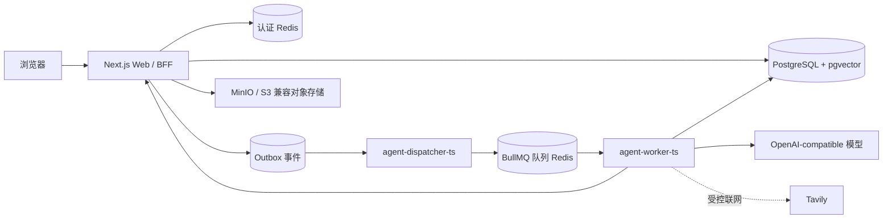

# LearnCraft

面向程序员的 AI 学习路线与实践平台。

LearnCraft 会根据学习者的背景、目标和前测结果组织学习路线，将每个章节拆成可阅读、可练习、可验证的学习节点，并通过后测和学习记录帮助学习者持续推进。项目采用 monorepo 结构，Web、Agent Worker、共享契约和本地基础设施均在同一个仓库中维护。

[](https://github.com/litieshan2331/LearnCraft/actions/workflows/ci.yml)
[](./LICENSE)

> 项目目前处于持续开发阶段。核心学习闭环已经可以在本地 Compose 环境联调。

## 功能概览

- **学习者账户与画像**：注册、登录、Session 管理，以及编程经验、每周可投入时间、内容偏好等学习画像。
- **自定义学习目标**：围绕技术主题和期望结果创建学习目标。
- **前测诊断**：生成 10–20 题的单选前测，按学习者水平安排难度和少量提高题，并进行确定性评分。
- **学习路线**：根据目标和前测结果生成 6–12 个章节，包含学习目标、难度、预计时长、前置依赖和完成标准。
- **节点内容**：为路线节点生成结构化知识内容、代码示例和 worked example，并支持节点完成标记。
- **节点后测**：围绕已经学习的节点生成 5–10 题后测，检验知识掌握和迁移能力。
- **Agent 运行观测**：查看运行状态、事件序列、生成进度和错误信息；进度事件不包含模型原文。
- **模型连接管理**：保存 OpenAI-compatible Provider 的 Base URL、模型名和 API Key；凭据在服务端使用 AES-256-GCM 加密保存。
- **学习助手（演进中）**：TypeScript Worker 中已经提供基于 LangGraph.js 的学习助手图、错题归因和苏格拉底导师子 Agent；公开对话链路仍在持续完善。

四个 P0 生成工作流由 TypeScript Agent Worker 执行：`assessment_generate`（前测）、`plan_generate`（学习路线）、`card_content_generate`（节点内容）和 `posttest_generate`（节点后测）。联网检索通过受控的 Tavily 网关完成，并受工具次数、每日配额、熔断和模型出网策略限制。

## 系统架构



一次 AgentRun 的基本链路是：Web 创建运行记录并写入 Outbox，Dispatcher 使用 `FOR UPDATE SKIP LOCKED` 领取事件并投递 BullMQ，Worker 执行工作流后通过内部接口回写结果，Web 在事务中完成业务数据落库。 `agent_run_id` 同时用于任务幂等和运行观测。

## 技术栈

| 层次 | 技术 |
| --- | --- |
| Web | Next.js 16、React 19、TypeScript、Tailwind CSS、shadcn/ui、Radix UI |
| 数据与持久化 | PostgreSQL 16、pgvector、Drizzle ORM、Drizzle Kit |
| Agent 运行时 | Node.js 22、LangChain、LangGraph.js、Zod |
| 异步任务 | BullMQ、Redis 7、PostgreSQL Outbox |
| 对象存储 | MinIO（本地）或 S3/R2 兼容服务（生产） |
| 外部模型 | OpenAI-compatible Provider；可选 Tavily 联网检索 |
| 工程工具 | pnpm workspace、Vitest、Playwright、ESLint、Docker Compose、GitHub Actions |

## 快速开始

### 环境要求

- Docker Desktop，启用 Docker Compose
- Node.js `>=20.9.0`
- pnpm `>=11.15.0`
- TypeScript Agent Worker 构建需要 Node.js `>=22.0.0`

### 启动本地环境

在仓库根目录执行：

```powershell
pnpm install --frozen-lockfile

Copy-Item infra/.env.example infra/.env
```

然后编辑 `infra/.env`，至少替换 PostgreSQL、两个 Redis、MinIO 和 `INTERNAL_SERVICE_SECRET` 的本地密码。首次联调 Agent 生成时，还需要配置：

- `CREDENTIAL_ENCRYPTION_KEY`：使用 `node -e "console.log(require('node:crypto').randomBytes(32).toString('base64'))"` 生成 32 字节 Base64 主密钥。
- 一个在 Web 中创建并设为默认的 OpenAI-compatible 模型连接。
- `TAVILY_API_KEY`：只有需要联网检索时才需要。
- `SILICONFLOW_API_KEY`：使用仓库锁定的 embedding profile 时填写。

启动 Compose：

```powershell
docker compose --env-file infra/.env -f infra/compose.yaml config
docker compose --env-file infra/.env -f infra/compose.yaml up --build -d
docker compose --env-file infra/.env -f infra/compose.yaml ps
```

查看数据库迁移服务：

```powershell
docker compose --env-file infra/.env -f infra/compose.yaml ps -a db-migrate
```

开发 Compose 启动时会先由一次性 `db-migrate` 服务执行全部 Drizzle 迁移，迁移成功后才启动 Web 和 Agent 服务。若需单独重跑迁移，可执行：

```powershell
docker compose --env-file infra/.env -f infra/compose.yaml run --rm db-migrate
```

浏览器访问 <http://127.0.0.1:3000>。本地服务端口默认只绑定 `127.0.0.1`，完整的服务说明、端口表和生产编排说明见 [`infra/README.md`](./infra/README.md)。

### Web 热更新

本地 Compose 已使用 `next dev` 并挂载 `apps/web` 源码。修改 Web 的 TypeScript、TSX 或 CSS 文件后会自动触发 Fast Refresh。修改 `apps/agent-worker-ts/src` 后，需要重新构建并重启两个 TypeScript 服务：

```powershell
docker compose -f infra/compose.yaml restart agent-worker-ts agent-dispatcher-ts
```

如果修改了依赖、Dockerfile、Compose 配置或环境变量，需要重新创建服务：

```powershell
docker compose -f infra/compose.yaml up --build -d agent-worker-ts agent-dispatcher-ts web
```

## 常用命令

以下命令均在仓库根目录执行：

```powershell
# Web
pnpm dev:web
pnpm build:web
pnpm lint:web
pnpm typecheck:web
pnpm test:web

# 数据库
pnpm db:generate
pnpm db:migrate
pnpm db:check

# TypeScript Agent Worker
pnpm build:agent-worker
pnpm typecheck:agent-worker
pnpm test:agent-worker

# 共享安全原语
pnpm typecheck:shared
pnpm test:shared
```

Agent 评测分为构建、运行和评分三个阶段：

```powershell
pnpm eval:build
pnpm eval:run -- --owner-id <用户UUID> --dataset evals/datasets/built.json --output evals/runs/smoke-001
pnpm eval:score -- --owner-id <用户UUID> --dataset evals/datasets/built.json --output evals/runs/smoke-001
```

评测需要独立的 Judge 模型连接；真实模型调用和真实数据库写入只应在本地开发环境中按需启用，具体开关和环境变量见 [`apps/agent-worker-ts/README.md`](./apps/agent-worker-ts/README.md)。

## 项目结构

```text
.
├─ apps/
│  ├─ web/                 # Next.js Web、BFF/Core API 与学习者界面
│  ├─ agent-worker-ts/     # 当前默认的 TypeScript Dispatcher、Worker 与 Agent 工作流
│  └─ agent-worker/        # Python 迁移参照实现与测试，不由 Compose 启动
├─ packages/
│  ├─ contracts/           # OpenAPI、事件和 TypeScript/Python 契约
│  └─ security-primitives/ # Web 与 Worker 共用的加密安全原语
├─ infra/
│  ├─ compose.yaml         # 本地开发编排
│  ├─ compose.production.yaml # 生产服务编排
│  └─ docker/              # Web 与 Agent 镜像定义
├─ docs/                   # 架构、迁移、UI 与运行边界文档
├─ evals/                  # Agent 评测数据集与运行结果
└─ scripts/                # 评测等开发脚本
```

## 配置与安全边界

- 不要提交 `infra/.env`、`infra/.env.production`、Provider API Key、Tavily Key 或 `CREDENTIAL_ENCRYPTION_KEY`。
- P0 embedding profile 已固定为 `SiliconFlow / BAAI/bge-m3 / 1024 / cosine / siliconflow-bge-m3-v1`。修改 Provider、模型或维度会影响已创建的向量表，应作为独立架构变更处理。
- 用户模型连接只接受公网 HTTPS 域名和 443 端口。真实模型请求只能由 Agent Worker 的 `SafeModelEgressClient` 发起，Web、Dispatcher 和 Runner 不直接访问用户填写的模型地址。
- 本地开发的 `SESSION_COOKIE_SECURE=false` 只适用于 HTTP；部署到 HTTPS 时必须改为 `true`，并设置实际的 `APP_ORIGIN`。
- 本地 Compose 的 PostgreSQL、Redis、队列 Redis 和 MinIO 端口只绑定到 `127.0.0.1`。生产环境应使用托管 PostgreSQL、Redis 和 S3/R2，并配置受控的模型出网代理。

## 文档导航

- [本地基础设施与生产 Compose](./infra/README.md)
- [Web 应用说明](./apps/web/README.md)
- [TypeScript Agent Worker](./apps/agent-worker-ts/README.md)
- [Python Agent 迁移参照](./apps/agent-worker/README.md)
- [Agent 架构设计](./docs/05-Agent架构设计.md)
- [全栈 TypeScript 迁移方案](./docs/09-全栈TypeScript迁移方案.md)
- [UI 改版路线与设计基线](./docs/08-UI改版路线与设计基线.md)

## 持续集成

GitHub Actions 会在推送到 `main`、创建或更新 Pull Request，以及手动触发时运行：

- TypeScript 工作区的类型检查、单元测试、Web lint 和 Agent 打包。
- Python 迁移参照的 Ruff 检查和 pytest。
- 本地与生产 Compose 配置解析和变量展开校验。
- Web 与 TypeScript Agent 生产镜像构建验证。

## 参与贡献

欢迎通过 Issue 或 Pull Request 反馈问题和提交改进。新增功能前请先阅读仓库根目录的 [`AGENTS.md`](./AGENTS.md)，并保持变更范围与需求一致；涉及数据库 schema、模型接入、成本、安全或上线行为的设计，请在实现前先明确决策和影响。

## 许可证

本项目采用 [MIT License](./LICENSE)。
