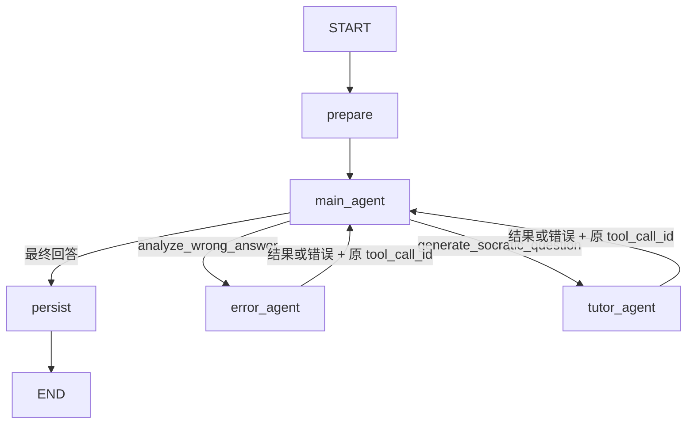

# 学习助手 Agent 图方案

本文描述学习助手当前采用的三 Agent 图结构。

## 流程图



## 三个 Agent

- **主 Agent**：处理用户对话，按需调用两个子 Agent；综合结果后生成最终回答。
- **错题归因 Agent**：只处理主 Agent 委派的错题分析任务。
- **苏格拉底导师 Agent**：只处理主 Agent 委派的启发式追问任务。

三个 Agent 是独立实例，各自使用固定提示词、工具白名单和 Checkpoint 命名空间。子 Agent 不能相互调用。它们只接收完成当前任务所需的 State 上下文，不共享主 Agent 的完整模型消息历史。

## 子 Agent 返回规则

1. 子 Agent 的成功结果是自由文本；不做 JSON 格式或业务语义校验，由主 Agent判断如何使用。
2. 子 Agent 完成后直接返回主 Agent，不经过 `child_result` 或 `main_resume` 节点。
3. 主 Agent 发起委派时产生的 `tool_call_id` 必须原样保存在 LangGraph State 中，并绑定子 Agent 返回的 `ToolMessage.tool_call_id`。
4. 成功结果和失败结果都使用同一个 `tool_call_id`。重试或 Checkpoint 恢复时沿用原 ID；重复恢复不得追加重复的工具结果。
5. 子 Agent 失败时，将脱敏错误作为对应的工具结果交回主 Agent，由主 Agent 决定重试、调用另一个子 Agent、降级回答或终止运行。不能让未处理异常直接结束父图，否则主 Agent 无法决策。

## State 交接

State 只保存路由和恢复所需信息，不解析子 Agent 文本：

```ts
type DelegationState = {
  toolCallId: string;
  target: "error_attribution" | "socratic_tutor";
  task: string;
  status: "requested" | "running" | "succeeded" | "failed";
  resultText: string | null;
  errorCode: string | null;
};
```

委派关系必须满足：主 Agent 的 `AIMessage.tool_calls[].id` = State 的 `toolCallId` = 返回 `ToolMessage.tool_call_id`。工具调用关联字段和 State 路由字段需要校验；`resultText` 保持原样自由文本。
